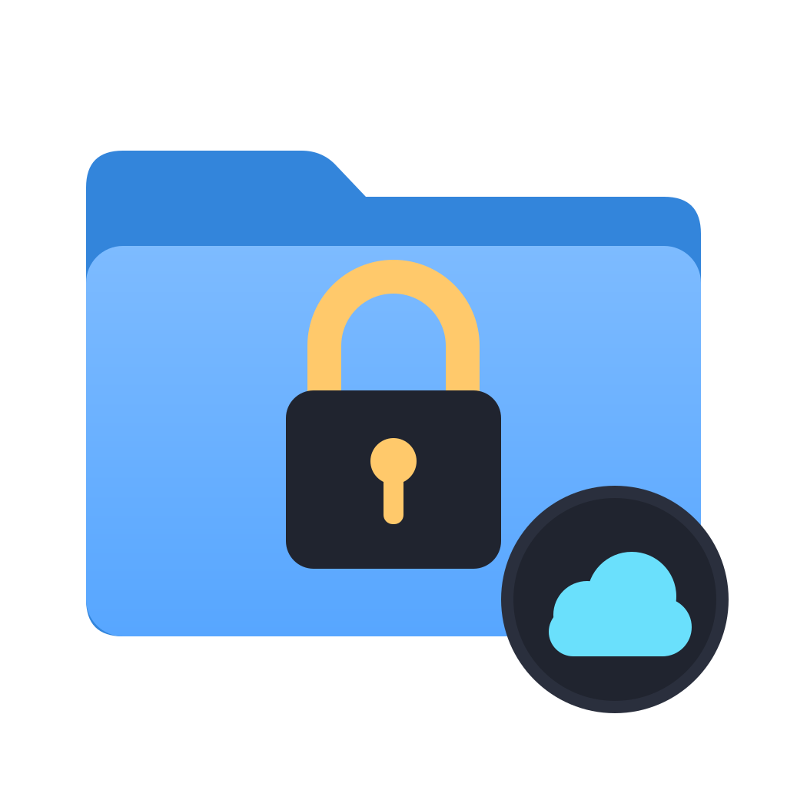

<!-- SPDX-FileCopyrightText: Copyright 2026 Alexander Orlov <info@lifub.com> -->

# ZeroTrust Drive

FUSE-based encrypted overlay filesystem. You work with decrypted files in the mount directory
while all data is stored encrypted at rest with XChaCha20-Poly1305 AEAD encryption, under a key
derived from your passphrase with Argon2id (the `.age` file extension is a naming convention -
not the age crate).

The cloud storage service receives user content and filesystem metadata only as ciphertext through
the backing directory. That store also exposes non-secret plaintext KDF parameters, object sizes,
names, timing, and account metadata. A provider's desktop sync process still runs on the endpoint
and may have local access to the separate plaintext mount, so ordinary endpoint security remains
necessary. New stores use the v2 format:
immutable authenticated chunks on a 4 MiB logical grid, sparse copy-on-write radix trees, immutable metadata
generations, and a small authenticated `_root.age` visibility pointer. A plaintext `_kdf.json`
holds only the key-derivation salt and bounded cost parameters (not secret - see
[Encryption](#encryption)). The encrypted index stores the full directory tree, permissions,
sizes, timestamps, and opaque file-root references. Without the correct passphrase, this metadata
and every data object are unreadable.

Point `--encrypted-dir` at a fully local cloud-sync folder and its provider handles replication
of the ciphertext. Placeholder/on-demand storage is not a safe backing filesystem for this tool.
For Google Drive, `zdrive` can instead replicate a store outside any synced folder through the
Drive API itself; see [Native Google Drive API sync](#native-google-drive-api-sync).

V2 does not buffer complete open files. Read, write, and flush memory are bounded independently of
logical file size: a bounded read decrypts at most one fixed-size chunk at a time in addition to
the bounded response buffer, and flush contains metadata rather than complete file content. Sparse
writes do not materialize holes. New, sparse, and short dirty tails retain only the bytes reached by
a write, beginning with a 4 KiB reservation and growing geometrically up to the 4 MiB chunk ceiling.
Changing an existing full base chunk still authenticates and retains that complete chunk. The
sixteen-slot limit caps retained logical dirty bytes and requested steady-state capacities at
64 MiB; allocator over-allocation and one transient old-plus-new buffer during growth add overhead.
Existing v1 stores still mount for compatibility and retain their legacy whole-file RAM behavior
until explicitly migrated with `--migrate-v2`.

If the selected authenticated root (or legacy v1 index), exact KDF metadata, or pinned control
topology changes externally while mounted, zerotrust-drive refuses the next local commit instead
of overwriting the external generation. It also fails closed when it finds provider-generated sibling
v1 blobs or indexes, the v2 root or object namespace, KDF metadata, or maintenance controls; iCloud
index-placeholder names; ambiguous non-UTF-8 top-level, control, or evidence entries; an unreferenced canonical blob that
could collide with future allocation; malformed or provider-conflicted staging names; or a stale
temp from an interrupted write. Valid transaction-ready files left before authenticated intent
publication remain unreferenced evidence: they are preserved, do not select a generation, and do
not prevent a fresh retry.
The mounted instance then latches read-only and persistence calls fail until remount, even if
synchronization later hides the conflicting artifact. Preserve every copy before reconciling.
Never mount the same store on two computers at once.

Metadata changes flush after 5 seconds without another change and after at most 30 seconds of
continuous dirty activity. Clean opens and clean `fsync` calls leave randomized ciphertext stable.
V2 writes fresh immutable objects and publishes an authenticated copy-on-write generation; only
the small `_root.age` pointer changes last. Updates atomically exchange it and retain the displaced
root as transaction evidence; the first generation is published with atomic no-replace.

### Quick start

1. Install zdrive. On Linux, install the `.deb` or the tarball from a
   [release](https://github.com/loxal/zerotrust-drive/releases), see
   [Linux installation](#linux-installation). On macOS, install
   [macFUSE](https://macfuse.github.io/) and the release's `zdrive-macos-aarch64` binary as
   `zdrive` on your `PATH`; with macFUSE 5 no kernel extension is needed (see
   [Prerequisites](#prerequisites)).
2. Run the guided setup with your Google account:

       zdrive setup --account you@gmail.com

   Setup shows its plan and asks before it changes anything. It asks twice for the drive
   passphrase (a new drive needs at least 12 characters), signs in to Google once in the browser or with a device
   code (see [Setup](#setup)), creates or joins the "ZeroTrust Drive" folder in My Drive, runs the
   first transfer and starts the drive automatically at login (macOS) or boot (Linux), see
   [Auto-start](#auto-start). By default the drive appears at `~/zdrive` and its encrypted store
   lives in `~/.local/share/zerotrust-drive/drive/store`.
3. Work in `~/zdrive`. Google only ever receives ciphertext.

Every question has a flag (`--name`, `--dir`, `--store`, `--passphrase-file`, `--no-autostart`,
`--yes`, ...; see `zdrive setup --help`), so setup also runs unattended. `zdrive doctor` checks an
installation without printing any secret.

**Unencrypted storage is opt-in.** `zdrive setup --plain` keeps an ordinary folder in sync with a
Drive folder of plain files that Google, and anyone with access to the account, can read; see
[Plain mode](#plain-mode). Encrypted storage stays the default.

**Your Google Drive on Linux.** Google offers no Drive app for Linux. `zdrive setup --mirror`
keeps all of My Drive as ordinary files in `~/GoogleDrive`, in both directions, as Drive for
desktop's "Mirror files" does; see [Mirror My Drive](#mirror-my-drive).

**Telemetry is on by default and never leaves your computer.** zdrive records local diagnostics
that help find performance and reliability problems; `zdrive telemetry off` turns them off. See
[Telemetry](#telemetry) and [PRIVACY.md](PRIVACY.md).

### Cloud backend guidance

For a new store on Google Drive, prefer [native Google Drive API sync](#native-google-drive-api-sync)
(beta since 0.17.0): it uploads a generation only after every object it needs, which Drive for
desktop does not guarantee, and it also runs on Linux. The folder-sync guidance below applies when
a desktop client replicates the encrypted folder.

API mode already keeps a complete copy on every side: every computer keeps a complete local
replica and Drive keeps a complete copy, with nothing streamed on demand. A Computers folder of
Drive for desktop is no better target: it backs up one computer and does not sync down to
another, Drive for desktop has no Linux client, and the bundled `drive.file` client cannot write
into a folder Drive for desktop created. In the [benchmark](#benchmark), a store in such a synced folder also took 1.1 to 39 times
as long to reach Drive and exposed incomplete generations.

For folder sync, the primary recommended beta backing target is a dedicated folder in Google Drive `My Drive`, with Google
Drive for desktop configured to **Mirror files**. Mirror mode keeps ordinary local files and
best matches the POSIX `fsync` and atomic-rename behavior used here. Do not use Google Drive
Stream mode or a Shared Drive as the backing store.

iCloud Drive is a macOS-only beta target. Mark the complete encrypted backing folder
**Keep Downloaded** before use. iCloud's File Provider placeholders and lack of a general
user-facing pause-sync control make migration and recovery less predictable. A safe exact-URL,
no-presenter `NSFileCoordinator` shim and capability-rooted storage boundary are implemented and
tested. The shim is Swift over a minimal Objective-C exception guard; the guard stays
Objective-C because Swift cannot catch the `NSException`s Foundation raises on misuse, and a
regression test proves an exception raised beneath Swift frames is contained instead of
aborting mid-commit. Pinned v2 immutable-object publication now uses the direct `StoreRoot` backend while
retaining descriptor-rooted `openat` writes and the same write, file-fsync, and directory-fsync
checkpoints. Coordinated production mode and every remaining backing path family are still
disabled and unwired; enabling only partial coordination would give a false guarantee and can
introduce nested-coordination failures. A local `NSFilePresenter` probe verifies exact
descriptor-rooted move notifications. Separate opt-in gates cover inherited Keep Downloaded
behavior, an eviction/download transition in an explicitly non-Keep-Downloaded folder, and the
complete normal-write/recovery `SIGKILL` matrix. They have not been run against user-selected
iCloud folders in this change set.
Apple says an individual iCloud Drive folder or file over 50 GB is usually marked Ineligible.
Treat that as a conservative operational ceiling rather than a precisely specified recursive
quota contract. The relevant planning number here is the complete accumulated ciphertext footprint,
including unreachable copy-on-write objects and retained evidence, not the visible plaintext size. Offline v2 GC can authenticate and
reversibly quarantine exact unreachable objects, but new physical purge is deliberately disabled:
portable pathname APIs cannot exclude a final concurrent rename, write, or hard-link race without
risking conflict evidence. Quarantine therefore does not reclaim space. Use iCloud only for stores
that remain comfortably below the limit, monitor the encrypted folder, and migrate away before it
approaches 50 GB.

Proton Drive is an experimental macOS backing target. Use a dedicated folder under `My files`,
mark the complete encrypted folder **Make Available Offline**, and verify the client's last
successful synchronization before mounting or moving to another device. Proton's macOS client
uses Apple File Provider, and Proton officially warns that large numbers of small files can take
substantially longer to synchronize. This is directly relevant to v2's immutable-object layout.
Proton's own end-to-end encryption is welcome defense in depth, but it is not part of this
project's trust argument: `zerotrust-drive` must independently encrypt and authenticate the data
before Proton receives it. Keep the ZeroTrust Drive passphrase separate, retain Proton's recovery
phrase or file outside Proton, and maintain an independent backup. The official Proton CLI is a
transfer tool rather than a mounted or continuously synchronized filesystem; rclone's
reverse-engineered Proton backend is not supported for a writable store.

Yandex Disk is an experimental secondary target, strongest when its official Linux sync daemon is
useful. Prefer a fully local synchronized folder, not WebDAV. Its documented upload cap is twice
the current storage capacity for a 30-day accounting period that begins with the first upload and
then resets every 30 days. This is a material constraint for immutable copy-on-write churn and
migrations. Yandex also warns that simultaneous multi-device editing can create duplicate conflict
copies or lose files. Keep the same one-writer and independent-backup discipline.

None of these providers supplies a multi-file transaction, a cross-machine writer lock, or a backup.
Use one active mount, wait for sync to finish before switching computers, and keep an independent
versioned snapshot. See the [2026 cloud backend and user-experience review](docs/cloud-storage-backends-2026-08.md)
for the technical tradeoffs, vendor documentation, and reported failure modes.

Normal v2 commits never overwrite a referenced data object. They publish every immutable chunk,
tree node, file root, index, and generation first; publish an AEAD-authenticated normal-write
manifest; then atomically switch `_root.age` last (exchange for an update, no-replace for the first
root). Recovery accepts only the exact authenticated old or new root and never falls back around a
corrupt object. Deterministic tests return an injected
error after every write, file fsync, namespace publication/rename, directory fsync,
evidence-retention, and recovery checkpoint, then retry recovery against that state. An opt-in
subprocess matrix also uses real `SIGKILL` after every checkpoint and verifies recovery in a fresh
process. The baseline 64-kill normal-write/recovery matrix passes on local APFS, local loopback
ext4, hosted APFS, and hosted x86 loopback ext4. [GitHub PR #1](https://github.com/loxal/zerotrust-drive/pull/1) recorded the hosted unit job in
2m19s, APFS in 1m17s, and x86 ext4 in 1m23s. Dedicated matrices also pass locally on APFS and in
hosted APFS/x86_64 loopback ext4: 22 GC quarantine plus 14 quarantine-recovery deaths, 9 GC restore plus 8 restore-recovery deaths, and
65 v1-to-v2 migration plus 29 pending-root recovery deaths. The migration matrix exposed and
helped fix completed-migration and late-publication root-sibling bypasses. The final expanded
[hosted run](https://github.com/loxal/zerotrust-drive/actions/runs/30805725643) passed the 216-test job in 1m58s,
APFS in 1m19s, and x86_64 loopback ext4 in 1m06s. The harnesses exercise `ZeroTrustFs` and maintenance
entrypoints directly; they are not live kernel-mounted FUSE tests. The maintenance suites repeat
death from selected canonical post-rename and pending-root recovery states, not every synthetic
malformed-artifact combination. Neither test emulates power loss,
torn sectors, controller caches, remote-provider ordering, or a device that lies about `fsync`;
the claim still relies on the documented filesystem contract. See the
[v2 crash-consistency argument](docs/v2-crash-consistency.md).

Each normal-write death is inspected in a fresh process before recovery: the
crash-visible root must authenticate either the byte-identical old generation
or the complete new generation and every reachable object. The matrices pin
their audited checkpoint counts, fail when their opt-in environment is absent,
and hosted CI verifies each exact test name before executing it.

The old-or-new proof is a local process-crash proof under the one-writer rule and a stable selected
object namespace during the root-publication syscall. The mount retains exact namespace,
`objects`, and `evidence` directory descriptors; immutable generation/index reads and writes use
the pinned `objects` descriptor. The v2 immutable-object write family enters through a direct
exact-path `StoreRoot` operation, requires that its parent descriptor is the same pinned directory,
and verifies each newly published final name, inode, link count, length, and bytes. Evidence
inventory, atomic no-replace moves, and durable manifest hard links use
the pinned `evidence` descriptor. Commit, recovery, and migration revalidate the canonical
directory identities around publication and evidence retention.
Those checks fail closed for a replacement present at a validation boundary, but POSIX cannot
atomically couple a child-directory identity check to the separate `_root.age` exchange. A provider
replacement in that final interval can be detected only after the root became visible. This is a
provider-concurrency beta limitation, not part of the process-crash proof; preserve all artifacts
and remount only after synchronization has settled.

Writable v2 startup traverses and authenticates every file root, tree, and chunk reachable from
the active generation. It authenticates the new-generation graph named by every retained manifest
or manifest-ready artifact, and it authenticates each completed update's exact displaced root.
Both sides are walked through their parent chains to the declared origin, validating every
historical index and file graph. Provider replacement therefore cannot leave apparently valid but
unusable conflict or lineage evidence. This prevents a partially synchronized machine from committing on top of
incompleteness present at startup, but can make mount time proportional to live and retained history and can force
placeholder downloads. The full scrub is not repeated before every commit; post-mount in-place
object loss or corruption can be inherited by a later metadata generation. Keep the complete
backing folder local before mounting.

A pending canonical write manifest is checked the same way before recovery changes any name: its
complete new lineage and its exact displaced old root and lineage must already be readable through
the retained namespace. Recovery cannot make incomplete evidence look completed for one mount.

V2 is currently a durability-focused beta. A bounded dirty overlay coalesces writes in up to sixteen
4 MiB slots (64 MiB worst case) across the mount before a root-last flush; compact tails begin at
4 KiB and grow only to the highest written byte. Pressure flushes the prior overlay before accepting
another chunk. This removes complete-file buffering and repeated object creation for edits that
remain in one dirty interval, but close/fsync-heavy workloads and many small files can still amplify
copy-on-write object counts and uploads. Evidence-aware orphan handling is explicit and offline: preview does not
modify the encrypted backing store or persist a plan, and quarantine is reversible. New physical
purge is refused before intent or tombstone creation because no supported portable primitive makes
it safe against concurrent inode mutation. The quarantine framework selects only authenticated objects proven
unreachable, never committed history or conflict/recovery evidence, but currently reclaims no
storage. Sustained write-heavy production use is not yet recommended.

Every push to `main` runs the hosted APFS and x86 loopback-ext4 SIGKILL matrices; they have
passed for every release since `0.13.0`. Since `0.16.0` the hosted Linux job also mounts the real
binary through the kernel (`tests/live_fuse.rs`) and checks that SIGINT, SIGTERM and SIGHUP
unmount, flush and exit cleanly, and that a busy mount keeps serving. The beta status is
unchanged: live macOS mount coverage, complete File Provider coordination, passing real
iCloud-backed tests, remote-provider ordering, and safe evidence retirement remain open.

Retired evidence to recheck before changing the v2 beta status:

- `docs/reliability-investigation-2026-08.md` - ZeroTrust Drive reliability investigation: v2
  durability findings, NSFileCoordinator and Proton Drive evaluations, the small-file measurement
  recipe and inline-`FileRoot` format decision, and APFS/ext4 kill-matrix verification records,
  2026-08-02 to 2026-08-05. Removed on 2026-10-10; read it with
  `git show 3bf59c0ca463:docs/reliability-investigation-2026-08.md`.

#### Opt-in iCloud integration gates

Create a dedicated disposable folder inside iCloud Drive, mark that exact folder **Keep
Downloaded** in Finder, wait for synchronization to settle, and pass its already-canonical absolute
path to the Keep Downloaded and SIGKILL gates. The harness creates only a random child below it.
A failed gate preserves that child for inspection. A successful gate also preserves the child: it
rechecks identities and a bounded random owner marker, then records exact directory names/types and
regular-file sizes/link counts/streaming byte digests. The SIGKILL gate retains its successful
traces plus separate conflict-bearing copies of all 64 death states; it never unlinks those
synthetic siblings or recursively deletes a provider-managed child.

    set -x ZDRIVE_RUN_ICLOUD_TESTS 1
    set -x ZDRIVE_ICLOUD_TEST_ROOT '/absolute/canonical/path/to/disposable iCloud folder'
    set -x ZDRIVE_ICLOUD_TEST_CONFIRM disposable-keep-downloaded-folder
    set keep_downloaded_test macos_integration_tests::real_icloud_keep_downloaded_gate
    cargo test --locked -- --list | string match -q "$keep_downloaded_test: test"
    cargo test --locked "$keep_downloaded_test" -- --exact --ignored --nocapture
    set sigkill_test v2::process_crash_tests::subprocess_sigkill_v2_durability_icloud
    cargo test --locked -- --list | string match -q "$sigkill_test: test"
    cargo test --locked "$sigkill_test" -- --exact --ignored --nocapture

Use a second disposable iCloud folder that is explicitly **not** marked Keep Downloaded for the
eviction/materialization transition. Keeping this separate avoids a self-contradictory test in
which iCloud correctly rematerializes an item because its parent is pinned locally. Wait until
Finder reports this second folder fully downloaded and synchronized before starting the gate.

    set -x ZDRIVE_RUN_ICLOUD_TESTS 1
    set -x ZDRIVE_ICLOUD_MATERIALIZATION_ROOT '/absolute/canonical/path/to/disposable evictable iCloud folder'
    set -x ZDRIVE_ICLOUD_MATERIALIZATION_CONFIRM disposable-evictable-folder
    set materialization_test macos_integration_tests::real_icloud_materialization_transition_gate
    cargo test --locked -- --list | string match -q "$materialization_test: test"
    cargo test --locked "$materialization_test" -- --exact --ignored --nocapture

Use these exact test names rather than a broad `cargo test --ignored`. An older
query-only audit,
`storage::tests::real_icloud_tree_is_currently_materialized_without_conflicts`,
also consumes `ZDRIVE_ICLOUD_TEST_ROOT` and scans that selected root itself by
pathname. It is retained for `StoreRoot` ubiquity-query coverage but does not
allocate the isolated child or prove Keep Downloaded policy.

The Keep Downloaded gate proves inherited policy, current/uploaded state, and exact fixture bytes.
The evictable-folder gate asks Foundation to remove only the local fixture copy, requires an
observed `NotDownloaded` state, downloads it again, and compares the complete tree inventory and
freshly reopened bytes. The SIGKILL gate preflights the child before 64 local process deaths,
compares its complete inventory after File Provider settles, and re-authenticates every clean and
conflict-bearing crash state. Each selected root must have one unambiguous policy and recursive
materialization state according to Apple's diagnostic `fileproviderctl evaluate`. Traversal is
descriptor-rooted and bounded by entry/byte/depth limits, cooperative deadline checks, and a 1 MiB
cap per diagnostic subprocess stream. One filesystem or Foundation call is not preemptible, so the
configured timeout is not a hard wall-clock kill switch. Set
`ZDRIVE_ICLOUD_TEST_TIMEOUT_SECS` to 30 through 3600 seconds when the default 900 seconds is
unsuitable. Passing these gates proves point-in-time
local APFS/File Provider behavior and settled retention of the synthetic recognized conflict
siblings. It does not prove provider-generated conflict metadata handling, remote upload order, or
atomic visibility on a second Mac.

Legacy v1 commits still have the historical blob-before-index crash window. Migrate important v1
stores before relying on root-last atomicity.

A brand-new store publishes `_kdf.json` before its first authenticated root. If initialization stops
between those publications, restart refuses the KDF-only directory because it is indistinguishable
from incompletely synchronized existing data. Preserve and inspect the directory; delete it only
when you can prove that no user data was ever committed, or restore the missing cloud generation.
KDF creation rechecks for a provider-arriving v1 index, v2 root, or write manifest immediately
before and after publication and retains its durable temp on conflict. POSIX still cannot
atomically test three independent control names while creating a fourth; a provider arrival in the
remaining interval can leave an incompatible canonical KDF beside preserved conflict evidence.
Do not delete either side automatically.
Back up `_kdf.json` separately with the encrypted store. Its salt is not secret, but losing or
corrupting this single file makes every ciphertext undecryptable even with the correct passphrase.

### Native Google Drive API sync

Since 0.17.0 `zdrive` can replicate a v2 store to Google Drive through the Drive REST API itself, as
rclone does for its encrypted remotes, instead of leaving the upload to Drive for desktop. The
store stays a complete local directory, outside every folder a desktop client syncs, on each
computer that uses it. `zdrive` uploads the objects it has already encrypted and authenticated, so
Google only ever receives ciphertext. This mode also works on Linux, which has no Google desktop
client. It is beta in 0.17.0.

Drive for desktop uploads changed files in its own order. In eight of the nine benchmark runs
below it made a new `_root.age` visible on Drive while objects that root needs were still
missing: for 24-31 seconds with up to 261 missing objects after writing a 1 GiB file, for 86-89
seconds with up to 654 missing after 200 small edits, and in two of three runs with 2,000 small
files for 504-510 seconds with up to 6,003 missing. A computer that synchronized during such a
window would receive a store it cannot open.
API mode creates a root record only after every object that root needs has been uploaded and
verified, so Drive always holds a complete generation.

#### Setup

[`zdrive setup`](#quick-start) runs every step below for you. To run them yourself, authorize a
named remote:

    zdrive remote auth --remote gdrive --account you@gmail.com

- Release builds carry zdrive's own Google OAuth client, listed as "ZeroTrust Drive", with the
  `drive.file` scope: zdrive sees only the files and folders it created itself, from any computer
  that uses this client, and never the rest of your Drive. Only a
  [mirror of My Drive](#mirror-my-drive) asks for full Drive access. It creates the folder "ZeroTrust Drive"
  in My Drive (`--folder-name NAME` chooses another name) or joins the one an earlier
  installation created. Before joining, it prints that folder's name, id, creation time, owner
  and the number of items at its top level; when several such folders exist it refuses and lists
  up to ten of them with the same details.
  `--folder-path A/B` places the remote at a nested path below My Drive instead, joining the
  folders an earlier installation created on that path. Folders you created yourself stay
  invisible to this client, so zdrive creates its own folder beside one of the same name.
- On a desktop the command opens the browser (`open` on macOS, `xdg-open` on Linux) and receives
  Google's answer on a loopback address, with PKCE and a `state` check. Over SSH, and on Linux
  without a graphical session, it prints a short code instead: open https://www.google.com/device
  on any phone or computer, enter the code and sign in. (Google's device sign-in cannot grant full
  Drive access, so a mirror prints an address to open instead and reads back the address the
  browser ends up at.) `--device-code` selects this flow
  anywhere. `--account` is suggested to Google, and a sign-in with another account is refused.
- The prompt asks for the store passphrase: it seals the refresh token with XChaCha20-Poly1305
  under an Argon2id key in `~/.config/zerotrust-drive/remotes/gdrive.json` (mode `0600`). Remote
  commands never accept the built-in demo passphrase or an empty one. After a rekey, run
  `zdrive remote auth` again. `--passphrase-file FILE` reads it from a file only you can read.

A Google app password cannot reach Drive: app passwords serve older apps that sign in with a
password, such as mail clients, while the Drive API accepts only OAuth. The one-time consent above takes its place;
after it, zdrive refreshes its access on its own.

Google has not yet verified the "ZeroTrust Drive" brand, so its consent screen shows no link to the
privacy policy; the policy is [PRIVACY.md](PRIVACY.md). Sign-in and access work the same. A mirror's
full Drive access is a restricted scope: until Google has verified the app for it, the sign-in
first shows "Google hasn't verified this app" (choose Advanced, then Go to ZeroTrust Drive), and
at most 100 Google accounts can grant it.

#### Bring your own OAuth client

A build from source contains no Google client (release builds receive it at build time), and a
remote in a folder that zdrive did not create, such as a Computers folder of Drive for desktop,
needs the full `drive` scope (a mirror of My Drive gets it through the bundled client). Both use
your own client:

1. In the Google Cloud console, create a project and enable the Google Drive API.
2. Configure the OAuth consent screen as **External** and **publish it to production**. An app
   left in "Testing" receives refresh tokens that expire after seven days.
3. Create an OAuth client of type **Desktop app**, download its JSON, and save it as
   `~/.config/zerotrust-drive/google-oauth-client.json` with mode `0600` (a build without the
   bundled client uses that file by default), or pass it with `--client-file FILE`.

Then authorize with a folder of your choice:

    zdrive remote auth --remote gdrive --client-file ~/client.json --folder-path zerotrust-drive

Google shows an "unverified app" warning at consent; for your own client that is expected.
`--folder-path` is a slash-separated path below My Drive or below `--folder-id ID`; missing
folders are created and duplicate names are refused. On a host without a browser, `--no-browser`
prints the address and reads the redirected address back. A remote configured with your own
client keeps it on later `remote auth` runs, and every token refresh uses the client that issued
the token.

#### Mounting with automatic sync

Keep the store out of synced folders, then mount it with `--remote`:

    zdrive --remote gdrive --encrypted-dir ~/zerotrust.drive.encrypted --decrypted-dir ~/z.drive

- Before mounting, `zdrive` fast-forwards the store to the remote head. On a new computer an absent
  or empty `--encrypted-dir` becomes a replica of the remote store; with an empty remote folder a
  new store is created there. Diverged histories are refused before anything is mounted.
- If Google Drive is unreachable, the drive mounts offline after a few seconds and uploads once
  Drive is reachable again.
- Every commit is uploaded shortly after it is durable locally. Bursts coalesce: intermediate
  generations travel as objects, and only the newest root record is written.
- Every 60 seconds the mount checks whether another replica has published. If one has, this mount
  latches read-only and explains how to recover; both histories stay preserved.
- A mounted replica refreshes an advisory lease every two minutes. Another replica's lease that was
  refreshed within ten minutes makes a new mount read-only.
- On unmount (Ctrl+C, SIGTERM or SIGHUP) the drive first flushes locally as before, then waits up to
  ten minutes for the final upload; another signal stops waiting. It exits with status 0 when
  Drive holds the final generation, and with status **75** when it does not. Local data is durable
  in both cases, and the message names the exact `zdrive remote push` command that finishes the
  upload.
- On macOS the volume is named "ZeroTrust Drive - Google Drive" ("ZeroTrust Drive" without
  `--remote`). `assets/icon/zerotrust-drive.icns` can be pasted onto a folder in Finder's Get Info
  window; the mounted volume keeps the macFUSE icon.

#### Explicit commands

    zdrive remote push   --remote gdrive --encrypted-dir DIR   # upload the local head and its objects
    zdrive remote pull   --remote gdrive --encrypted-dir DIR   # fast-forward; an empty DIR becomes a replica
    zdrive remote status --remote gdrive --encrypted-dir DIR   # compare heads without changing either
    zdrive remote verify --remote gdrive --encrypted-dir DIR   # audit the remote copy; --full downloads every pack

`push` and `pull` take the store's transaction lock, so they refuse a mounted store; a mount with
`--remote` already does both. `status` reports one of: in sync, local ahead (push), remote ahead
(pull), no remote store, remote store without a generation, a different store (other key
material), DIVERGED or FORKED, and exits with status 1 for the last three. A push resumes
interrupted uploads, including a resumable upload session that a killed process had begun.

#### Removing a remote

    zdrive remote remove gdrive            # forget the remote on this computer
    zdrive remote remove gdrive --revoke   # also end the Google sign-in

`remote remove` deletes only this computer's records of the remote: its configuration, its sealed
Google credential and its sync state (or, for a plain remote, its index and lock). The local
store or folder, a plain folder's local trash and everything on Drive stay; the summary prints the
Drive folder's address so you can move it to the Drive bin yourself. It refuses while a service
definition uses the remote, naming each one, and while a sync or mount holds the replica. It asks
before removing on a terminal and needs `--yes` otherwise.

`--revoke` first revokes the Google grant. Google ends the whole grant of the bundled client,
which signs out **every** zdrive install of that Google account, on every computer; the
confirmation names the other remotes on this computer that share the account. An already revoked
grant counts as done; when the revocation fails, nothing is removed. An encrypted remote needs the
store passphrase to unseal its credential.

#### Remote layout

Inside the chosen Drive folder:

    zdrive-remote.json             plaintext marker: remote format, store format, creating version
    _kdf.json                      exact copy of the store's non-secret KDF parameters
    packs/<id>.zpk                 encrypted .z2 objects concatenated into packs of about 64 MiB
    roots/<generation>-<id>.zr     exact bytes of each uploaded _root.age
    leases/                        advisory leases of mounted replicas, named by random replica ids

Files are created once under an id reserved in advance, so a retried upload cannot create a
duplicate, and they are never overwritten or deleted. Drive offers no conditional update, so a
push lists `roots/` first and refuses when Drive's head is not the generation this replica last
synchronized; two different records for one generation are a fork that every command refuses to
touch. A pull authenticates the root, requires the local head to be its ancestor, and installs
only objects that root reaches, each checked against its authenticated digest. Per-replica sync
state lives in `$XDG_STATE_HOME/zerotrust-drive/remotes/<name>/` (default `~/.local/state`), never
inside the store.

#### What Google sees

Google stores ciphertext, the non-secret KDF parameters, the number and sizes of packs, the
generation numbers in root-record names, upload times, lease heartbeat times, and the OAuth
client that uploaded them. It never receives a passphrase, a key, a file name, or plaintext
content. Anyone holding the Google account can still delete or roll back the remote copy, so
keep an independent backup.

#### Benchmark

Same encrypted stores, same Google account and the same home Internet connection, on an M3 Max
(14 cores, 36 GB RAM). The workloads were generated through
`ZeroTrustFs` without a kernel mount; each arm received byte-identical work. Drive for desktop
mirrored a folder in its normal Mirror configuration; `zdrive` pushed through the API. Times run
from local durability to the moment Drive held what another computer needs to open the final
generation: its root, the key material and every object. For `zdrive` that moment is the
creation and verification of the root record. For Drive for desktop it comes from listing the
folder through the API every two seconds, or as fast as a listing completes (about four seconds
for 6,006 files), until those files matched by size and MD5, so its times may be up to one
listing too long. Medians of three runs, alternating which arm went first:

| Workload | Store files | `zdrive` push | Drive for desktop | Native broken-root window |
|---|---|---|---|---|
| W1: one 1 GiB file | 264 | 35.6 s (21 Drive files) | 39.6 s | 24-31 s in every run, up to 261 objects missing |
| W2: 2,000 files of 4-64 KiB | 6,006 | 13.6 s (5 Drive files) | 528 s | 504-510 s in two of three runs, up to 6,003 objects missing |
| W3: 200 fsync'd edits to a 64 MiB file | 1,624 | 15.6 s (25 Drive files) | 119 s | 86-89 s in every run, up to 654 objects missing |

The W1 runs ranged 35.3-36.3 s for `zdrive` and 39.5-41.6 s for Drive for desktop. For W3 the
clock starts at the last edit's fsync; both arms uploaded while the edits ran. Drive for desktop
also uploads the store's local evidence files, which `zdrive` does not replicate because a
replica does not need them. In four of seven W3 runs, counting an earlier series, it still
lacked one or two files of the store when observation ended after 10-20 minutes; each one
identified was an evidence file. A fresh pull of W1 onto an empty directory took 30 s (median);
of W2, 38 s, which was bounded by one file and directory sync per installed object. Since 0.19.0 a
pull fsyncs each object as it is written and makes them all durable with one directory barrier
before the new root is installed; in interleaved release-build runs of the same 2,000-file pull on
this Mac, four rounds each, the median fell from 35.4 s to 6.0 s. Requests were not counted. The harness is
`src/remote/bench_tests.rs`; it needs a configured remote and runs only when asked.

#### Limits

- Drive keeps every pack and root record: there is no remote garbage collection yet, so the Drive
  footprint grows with every change, like the local store.
- A pull downloads the missing packs before installing their objects, so it temporarily needs
  about twice the missing data in free disk space.
- MD5 only proves the transfer. Corruption on Drive behind a correct MD5 is caught when a pull
  authenticates the objects, or by `zdrive remote verify --full`.
- Leases depend on clocks and on Drive listings, which may lag; they are skipped offline. Two
  computers mounted offline can therefore diverge. The second to push is refused and keeps its
  history; nothing is merged automatically. Use one active mount.
- If two computers create the remote store at the same moment, the store whose marker has the
  smaller id wins and the other is refused.
- v1 stores are refused; run `--migrate-v2` first.

### Plain mode

Plain mode is the opt-in alternative to encryption: an ordinary local folder kept in two-way sync
with a Drive folder of plain files. **Google, and anyone with access to the account, can read
every file**, and the files are readable in the Drive web interface. It needs no FUSE.

    zdrive setup --plain --account you@gmail.com       # folder ~/zdrive, Drive "ZeroTrust Drive (plain)"
    zdrive sync --remote plain --dir ~/zdrive          # one sync now
    zdrive sync --remote plain --dir ~/zdrive --watch  # keep syncing, every 15 s (--interval SECS)

Setup signs in, creates or joins the marked Drive folder, runs the first sync and installs
[auto-start](#auto-start), which runs `zdrive sync --watch`. Joining brings that folder's files to
this computer, so a plain folder found in My Drive is described first and joined only after a
yes on the terminal or with `--yes`; without either, nothing is saved. A folder named with
`--folder-id` or `--folder-path` is joined without asking. The first SIGINT or SIGTERM finishes
the current cycle and runs a final one; a second stops at once.

Each cycle first applies Drive's change feed, then uploads what changed locally:

- A download lands in a temporary file next to its target, is checked against Drive's size and
  MD5 and flushed to disk, and only then replaces the file, and only if the local file is still
  the version zdrive last synced. The replaced version goes to the local trash described below.
- If a file changed on both sides, both versions are kept: the Drive version is renamed to
  `name (conflict YYYY-MM-DD HHMMSS host).ext` on Drive and locally, and the local version is
  uploaded as a new Drive file.
- An edit updates the Drive file in place, so its sharing and version history stay; a local
  rename or move becomes a move on Drive.
- A local deletion moves the Drive file to the Drive bin, recoverable for 30 days. A deletion on
  Drive moves the local file into `~/.local/share/zerotrust-drive/<name>/trash/`, kept for 30 days;
  zdrive never deletes a synced file outright. If the local file changed meanwhile, it is kept and
  uploaded again instead.
- Files modified less than two seconds ago wait for a later cycle, and an upload whose file
  changes while it is read is retried in the next cycle.
- Symbolic links, sockets, devices, other file systems and names that are not UTF-8 are skipped
  and counted; `.DS_Store`, `._*` and zdrive's own `.zdrive-*` names are ignored.

The index lives in `~/.local/state/zerotrust-drive/plain/<name>.json` and binds the remote to one
local folder: a remote has one plain replica per computer. The folder may not contain, or lie
inside, zdrive's own configuration, state or data folders.

Limits:

- With the bundled sign-in (`drive.file`), zdrive sees only the files zdrive itself created, on
  any computer. Files added through the Drive web interface or another app do not sync down;
  with your own OAuth client (full `drive` scope) or in a [mirror](#mirror-my-drive) they do. Google Docs, Sheets and other
  Google-native documents never sync, since they have no file content.
- Concurrent writers resolve through conflict copies, not locks. When both sides rename the same
  item, the local name wins.
- Names that differ only in letter case or Unicode normalization collide on macOS and become
  conflict copies.
- Hard links upload as separate files.
- An interrupted large upload starts again from the beginning after a restart.
- A Drive edit that lands in the moment between zdrive's check and its upload can be overwritten;
  Drive keeps the overwritten content as an earlier revision of the file, typically for 30 days.

On macOS, if you already run Drive for desktop and only need plain files backed up, adding the
folder there (Computers) works without zdrive.

A sync never empties Drive because the local folder was emptied. A cycle moves nothing to the
Drive bin when it would bin more than 50 synced items that are also more than a tenth of all synced
items, when every one of ten or more synced items is missing, or when the folder lost the
`.zdrive-root-id` file that binds it to its index (a folder replaced by another file system, or
restored without it). The missing items stay on Drive, and the warning names the command that
applies the deletions after you checked them: `zdrive sync --remote NAME --dir DIR
--allow-deletions N`. A service never applies them by itself. A Drive folder is moved to the bin in
one step only while everything in it is synced; otherwise its synced contents go one by one and
the folder stays, so Google Docs or files zdrive never saw are not binned along with it. A file
whose owner does not allow you to download, change or delete it is set aside for an hour (doubling
up to a day) instead of being tried again every cycle, until it changes on Drive.

### Mirror My Drive

Google offers no Drive app for Linux. A mirror keeps all of your My Drive as ordinary files in a
local folder and syncs both ways, as Drive for desktop does with "Mirror files": every file is a
complete local copy, nothing is streamed on demand, and changes on either side reach the other.
**The files are not encrypted** - they are your existing Drive files, which Google can read. On
Ubuntu:

    sudo apt install ./zerotrust-drive_0.19.0_amd64.deb      # or _arm64.deb
    zdrive setup --mirror --account you@gmail.com

Setup explains the plan and asks before it changes anything. It signs in with full Drive access:
Google first warns that "ZeroTrust Drive" is not verified yet; choose Advanced, then Go to
ZeroTrust Drive, and allow access to your Google Drive files. Then it shows what My Drive holds -
files, bytes, and the Google Docs that stay on Drive - against the free space, and asks before the
first download. The folder `~/GoogleDrive` (`--dir DIR` chooses another) must be empty, so that
nothing already in it is uploaded into My Drive by mistake. With auto-start (the default) the
service downloads in the background and keeps syncing from then on; follow it with
`zdrive service status mirror` or `journalctl --user -u zerotrust-drive@mirror -f`. On a server
without a browser, setup prints an address to open on any computer; after the approval, paste the
address the browser ends up at (it starts with `http://127.0.0.1`, and may show an error page).

Without setup, the same takes two steps:

    zdrive remote auth --remote mirror --mirror --account you@gmail.com
    zdrive sync --remote mirror --dir ~/GoogleDrive --watch

A mirror follows the rules of [Plain mode](#plain-mode), including its local trash, conflict copies
and deletion guard, with these differences:

- Nothing is renamed on Drive. Two Drive files with the same name in one folder become
  `name.ext` and `name (2).ext` locally; a Drive name that cannot be a file name keeps its Drive
  name and gets a local one (`/` becomes `／`, too long a name is shortened with a short hash).
  zdrive remembers the Drive name, so edits, moves and deletions reach the right file. Renaming a
  file locally renames it on Drive.
- When a file changed on both sides, the Drive version keeps the name, and the local version
  becomes `name (conflict YYYY-MM-DD HHMMSS host).ext`, uploaded as a new Drive file.
- Google Docs, Sheets, Slides, forms and shortcuts have no file to download; they stay on Drive
  only. Files others shared with you that you did not add to My Drive are left out, and so are
  shared drives and zdrive's own encrypted and plain folders.
- The first listing asks for the contents of up to 50 folders at once, and up to four files
  download at the same time. Uploads go one at a time, about one to two seconds per small file.

`zdrive remote remove mirror` stops the mirror on this computer and keeps both the local files and
My Drive as they are.

### Auto-start

`zdrive setup` installs auto-start unless `--no-autostart` is given; `zdrive service` manages it
afterwards:

    zdrive service install --name drive --remote drive \
        --encrypted-dir ~/.local/share/zerotrust-drive/drive/store --mount-dir ~/zdrive
    zdrive service list                    # every instance with its state
    zdrive service status drive
    zdrive service uninstall drive         # keeps the definition; --purge --yes deletes it

An instance is defined once in `~/.config/zerotrust-drive/services/<name>.json` (mode `0600`).
The service manager only runs `zdrive service run <name>`, which reads that definition, recovers a
stale FUSE mount left by a crash, and then mounts the drive (or, in plain mode, keeps the folder
in sync).

- **macOS:** a LaunchAgent `~/Library/LaunchAgents/net.loxal.zerotrust-drive.<name>.plist` starts
  the drive at login and restarts it after a failure. Its log is
  `~/Library/Logs/zerotrust-drive/<name>.log`. The mount relies on the macFUSE approval you gave
  when installing macFUSE.
- **Linux:** a systemd user unit `zerotrust-drive@<name>.service` (`Type=notify`, restarted on
  failure) starts the drive at boot. Boot start needs lingering for your user; zdrive enables it
  when polkit allows, and otherwise prints the exact `sudo loginctl enable-linger <user>` to run.
  Logs: `journalctl --user -u zerotrust-drive@<name>`.

A failure that cannot heal by itself stops the service instead of restarting it forever: a wrong
passphrase, a missing remote or service definition, a refused or binned Drive folder, a revoked
Google sign-in or an invalid mount point. The drive records the cause under
`~/.local/state/zerotrust-drive/services/<name>.refusal.json` and exits with status 78
(`EX_CONFIG`) on Linux, which the unit excludes with `RestartPreventExitStatus=78`, or 0 on macOS,
where the LaunchAgent restarts only after an unsuccessful exit. `zdrive service status <name>` and
`zdrive doctor` show the cause with the exact fix; `zdrive service install --name <name>` clears it
and starts the service again. Network outages, a busy mount point and I/O errors stay transient and
are restarted as before. Since 0.19.0; `zdrive doctor` flags an auto-start entry an older zdrive
generated, and `zdrive service install --name <name>` rewrites it.

An unattended encrypted drive needs its passphrase without a terminal. On Linux with systemd 256 or
newer, zdrive encrypts it with `systemd-creds --user`, bound to the machine's TPM or host key,
into `services/<name>.cred`; systemd hands it to the drive only while it runs. Elsewhere, including
macOS and Ubuntu 24.04, it is kept in a file only you can read (`services/<name>.passphrase`, mode
`0600`, or your own file through `--passphrase-file`). Anyone who can read that file, or a backup
of it, can decrypt the drive, so keep the home directory protected. `--custody` selects the
method explicitly; after a passphrase rotation, run `zdrive service install --name <name>
--replace-passphrase`.

On stop, the drive flushes locally and then waits up to 60 seconds (`--final-push-wait SECS`) for
its last upload. Data that missed it is durable locally and is uploaded first on the next start.
If a program still uses the drive, for example a terminal whose current directory is inside it,
the drive keeps serving and retries the unmount every second. After 90 seconds systemd or launchd
kills it. It keeps flushing acknowledged writes within 5 to 30 seconds while it waits, so only
writes from those last seconds can be lost, and the next start clears the stale mount.

At shutdown, systemd stops your user manager, and with it every user unit, within the user
manager's own stop timeout. Ubuntu's systemd package lowers that to 5 seconds
(`/usr/lib/systemd/system/user@.service.d/timeout.conf`) so that a hanging desktop service cannot
delay a shutdown, so on Ubuntu a final upload still running after 5 seconds is cut short. The
drive unmounts and flushes locally before it uploads, which normally takes well under a second,
and the next start uploads the rest; only another computer sees those last writes later. `zdrive
doctor` and `zdrive service install` report a timeout below 90 seconds. To give the final upload
the full 90 seconds, at the cost of shutdowns waiting that long for any hanging user service:

    sudo mkdir -p /etc/systemd/system/user@.service.d
    printf '[Service]\nTimeoutStopSec=90\n' | sudo tee /etc/systemd/system/user@.service.d/zz-zerotrust-drive.conf
    sudo systemctl daemon-reload

### Telemetry

zdrive keeps local diagnostics so that performance, resilience and reliability problems can be
found and fixed from evidence. **Nothing is ever uploaded.** Records are JSON lines in
`~/.local/state/zerotrust-drive/telemetry/<instance>/YYYYMMDD.jsonl`, kept for 30 days and capped
at 64 MiB (256 MiB at `full`).

| Level | Records |
|---|---|
| `off` | nothing; existing records stay until `zdrive telemetry purge --yes` |
| `standard` (default) | start and stop, one snapshot a minute, errors, sync and Google Drive request summaries |
| `full` | also a snapshot every 10 seconds, every operation slower than 250 ms, every Drive request with its status and retries, sync step events, and crash messages with paths removed |

Snapshots carry FUSE operation counts, latency histograms and error codes, store commit and fsync
times, upload and download volumes, retries and rate limits, and the process's memory, CPU time and
number of open files. Records never contain file or folder names, paths inside the drive, file
contents, passphrases, tokens, OAuth client secrets or your email address. A test drives the store,
sync and crash paths at `full` with canary names, paths and contents and searches every recorded
byte for them.

    zdrive telemetry status                # level, where it came from, location and size
    zdrive telemetry report --since 24h    # latency percentiles, errors, retries, restarts, crashes
    zdrive telemetry report --json         # the same as one JSON object, for tools and agents
    zdrive telemetry export --output zdrive-telemetry.tar   # to share manually
    zdrive telemetry off                   # or: telemetry level standard|full, telemetry on
    zdrive telemetry purge --yes

The level comes from `--telemetry LEVEL`, then the `ZDRIVE_TELEMETRY` environment variable, then
`~/.config/zerotrust-drive/telemetry.json` (written by the commands above), then `standard`.
Recording never blocks the drive: a full disk or an unwritable telemetry directory only loses
records, which are counted.

#### Overhead

Recording a file operation costs two clock reads and a few atomic counter updates; all file writes
happen on a separate thread. Before 0.18.0 was released, its cost was measured end to end against
0.17.0 through a real FUSE mount in an arm64 Linux container on an M3 Max, without Google Drive:

* W2 writes 2,000 small files and reads them back.
* W3 makes 200 fsync'd 4 KiB edits to a 64 MiB file.

Each workload ran nine times for each of four variants: 0.17.0, and 0.18.0 with telemetry `off`,
`standard` and `full`. Within each run the variants executed back to back, in a rotating order.
The ratios below pair each 0.18.0 variant with the 0.17.0 run from the same round; the brackets
give a 95% bootstrap interval.

| Workload | 0.17.0 median | `off` | `standard` | `full` |
|---|---|---|---|---|
| W2 | 17.8 s | 0.96 [0.90, 1.12] | 1.09 [0.89, 1.50] | 1.05 [1.00, 1.08] |
| W3 | 11.5 s | 1.04 [0.98, 1.07] | 1.04 [0.97, 1.16] | 1.05 [1.01, 1.21] |

**The result is inconclusive.** The declared margins were at most 3% slower at `standard` and at
most 5% at `full`. No interval fits within its margin, and none lies wholly above it, so neither
non-regression nor a regression is shown.

The host was shared, with a load average of 11 to 15. Back-to-back runs of the same round differed
by up to a factor of two, and the run-to-run spread exceeds the margins. Compared with 0.18.0 at
`off`, which is the same binary, the median cost is between -2% and +8%, with intervals reaching
+35%.

Every 0.18.0 variant's median p99 latency stayed within the range of 0.17.0's runs. All 72 runs
completed and unmounted cleanly, and no telemetry byte contained a canary file name. Telemetry
used at most 8 KiB per run.

A quiet-host rerun is listed in `TODO.md`. The artifacts, by SHA-256 prefix:

* zdrive 0.17.0 (07199d8): 779d9efa
* zdrive 0.18.0 (release tree): 238f3ad1
* harness: 7d93b14d

### Prerequisites

A FUSE implementation is required. Install the one for your OS:

- **macOS** - [macFUSE](https://macfuse.github.io/)
- **Linux** - FUSE 3 (the `fuse3` package; the `.deb` below installs it for you)
- **Windows** - not supported (would require [WinFSP](https://winfsp.dev/) and a different FUSE crate)

[Plain mode](#plain-mode) needs no FUSE. `zdrive doctor` reports whether FUSE is ready, which
macFUSE version is installed, and which backend a mount will use.

On macOS, macFUSE offers two backends, chosen with `--fuse-backend auto|kext|fskit` on a mount,
`zdrive setup` and `zdrive service install`:

- `kext`: macFUSE's kernel extension, which loads at the first mount once macOS allows it under
  System Settings > Privacy & Security; on Apple silicon, kernel extensions must first be enabled
  in recoveryOS.
- `fskit` (since 0.19.0): macFUSE 5's FSKit module (macOS 15.4 or newer), which runs in user
  space and needs no kernel extension. Enable it under System Settings > General > Login Items & Extensions > File System
  Extensions. On macFUSE before 5.5.0, a killed drive leaves its FSKit volume hung; `zdrive
  doctor` warns about this and names the process to end.
- `auto` (the default) uses the kernel extension when it is loaded and otherwise the FSKit module
  when macOS lists it as enabled. A service stores the backend only when it is not `auto`.

Linux refuses the macOS backends.

#### Linux installation

Every release has packages for x86_64 (`amd64`) and aarch64 (`arm64`) that run on Debian 12,
Ubuntu 22.04 and newer, and other distributions with glibc 2.34 or newer. On Debian and Ubuntu,
download the `.deb` from the [releases page](https://github.com/loxal/zerotrust-drive/releases)
and install it with apt, which also pulls in `fuse3`:

    sudo apt install ./zerotrust-drive_0.19.0_amd64.deb    # or zerotrust-drive_0.19.0_arm64.deb
    zdrive --version

On other distributions, install `fuse3` with the package manager (it provides `fusermount3`,
which mounts the drive for a regular user) and unpack the tarball instead:

    tar -xzf zdrive-0.19.0-linux-x86_64.tar.gz             # or zdrive-0.19.0-linux-aarch64.tar.gz
    sudo install -m 0755 zdrive-0.19.0-linux-x86_64/zdrive /usr/local/bin/zdrive

Each release also lists `SHA256SUMS`; check the downloads with
`sha256sum --check --ignore-missing SHA256SUMS`. Building from source (see
[Building](#building)) needs Rust and a C compiler (`build-essential` on Debian and Ubuntu); the
FUSE crate mounts through `fusermount3`, so neither `libfuse3-dev` nor `pkg-config` is required.

After installing, run `zdrive setup` for the guided first-time configuration.

#### macOS: permissions troubleshooting

On macOS, the privacy framework (TCC) can restrict access when the backing or mount location is
protected. An "Operation not permitted" or "Permission denied" result can also mean that the
mount is absent or ordinary directory permissions are wrong, so verify those conditions first.

If the location is TCC-protected, go to **System Settings > Privacy & Security > Full Disk
Access** and enable access for the terminal or application using the mount.

### Directory Layout

    ~/.local/share/zerotrust-drive/store/   encrypted store of a bare `zdrive` ($XDG_DATA_HOME; ciphertext + non-secret KDF salt)
    ~/z.drive/                              FUSE mount point of a bare `zdrive` - local (you work here)
    ~/.local/share/zerotrust-drive/<name>/  store of a drive set up with `zdrive setup --name <name>`
    ~/.config/zerotrust-drive/              remotes, service definitions, telemetry level (all 0600)
    ~/.local/state/zerotrust-drive/         per-replica sync state and telemetry

The encrypted directory is auto-managed by zerotrust-drive. Do not modify its contents directly.
Both paths are overridable via justfile variables or CLI flags `--encrypted-dir` / `--decrypted-dir`.

**Changed in 0.18:** a bare `zdrive` used to keep its store in
`~/g.drive/.zerotrust.drive.encrypted`, inside a Drive for desktop folder. If that store exists and
the new default does not, zdrive refuses to start rather than create an empty drive beside it, and
names both choices: mount the old store with `--encrypted-dir ~/g.drive/.zerotrust.drive.encrypted`,
or move it, while it is not mounted, to `~/.local/share/zerotrust-drive/store`.

### Usage

    just mount                                          # mount or create; prompts for the passphrase
    just populate                                       # create test files on the mounted filesystem
    just umount                                         # unmount (decrypted dir becomes empty)
    just mount                                          # remount - files reappear from encrypted storage
    cargo run -- --migrate-v2                           # explicitly migrate a v1 store, resumably
    just test                                           # run unit tests
    just release                                        # build optimized release binary
    just clean                                          # remove build artifacts (never the store)
    zdrive --version                                    # print the installed version

#### Stopping

Press Ctrl+C in the mounting terminal, or send SIGTERM or SIGHUP, to unmount. The drive then
flushes every acknowledged write to encrypted storage and exits with status 0, or 1 if any write
could not be persisted. If a program still has a file open, the unmount is refused rather than detached: the
drive reports it and keeps serving, and the next Ctrl+C or signal tries again once the file is
closed. A drive run as a service (`--service`, which `zdrive service` instances use) gets no second
signal, so it retries the unmount every second by itself until the file is closed. `just umount` and an external `umount` / `fusermount3 -u` flush the same way. A signal
received before the drive is mounted, for example at the passphrase prompt, restores the terminal
and terminates as usual.

### Offline v2 orphan quarantine

Unmount the store everywhere, wait for every provider to report synchronization complete, make an
independent snapshot, and pause synchronization on every device. Preview does not modify the
encrypted backing store or persist a GC plan; it only acquires a local advisory process lock outside
that store:

    zerotrust-drive --encrypted-dir /fully/local/store --gc-v2

Copy the exact plan ID from that preview. Quarantine moves only the named, still-unreachable
immutable object bytes into its plan directory without unlinking those bytes; it is resumable and
reversible:

    zerotrust-drive --encrypted-dir /fully/local/store --gc-v2-quarantine PLAN_ID --confirm-sync-paused
    zerotrust-drive --encrypted-dir /fully/local/store --gc-v2-restore PLAN_ID --confirm-sync-paused

The `--gc-v2-purge` flag is retained only to finish authenticated compatibility evidence for an
already-reclaimed zero tombstone. A new purge authenticates and revalidates the plan, then returns
an unsupported error without changing any name or byte, publishing intent, or creating tombstones:

    zerotrust-drive --encrypted-dir /fully/local/store --gc-v2-purge PLAN_ID --confirm-sync-paused

Every plan-consuming operation re-authenticates the plan, and every GC action holds the one-writer
process lock. Preview,
quarantine, and compatibility purge reject pending maintenance, provider siblings, unknown evidence, and stale
live roots or object inventory. Restore is deliberately narrower and additive: before purge intent
exists, it authenticates the current key, stored plan, GC controls, and exact candidate state, then
can put the planned objects back even if unrelated live roots or evidence changed after quarantine.
Missing planned bytes or ambiguous source/quarantine copies fail closed. Existing full tombstones
and quarantined bytes are preserved; only a pre-existing, authenticated all-zero compatibility
state can publish purge completion. Compact authenticated GC records and append-only staged-control
evidence remain. Plans use portable authenticated store identity rather than a host-local absolute
path; old
path-bearing plans remain readable after relocation. V1 preview does not modify the encrypted
backing store or persist GC state. This collector does not retire committed generations or
recognized conflict/recovery evidence, and it cannot prove that a remote provider replica is
current.

GC uses one shared 250,000-entry budget across immutable-object and namespace inventory, ready
controls, normal-write and migration evidence, migration receipts, GC operations, controls,
quarantines, and compatibility tombstones. Its authenticated plan ciphertext is capped at 64 MiB;
preview refuses an oversized scan or plan before creating GC state.

### Passphrase

The passphrase comes from the first available source:

1. the `ZEROTRUST_PASSPHRASE` environment variable;
2. the `--passphrase` flag, which is visible to other local users in the process list and is
   kept for compatibility;
3. a prompt on the controlling terminal with echo off. A new store asks twice so a typo cannot
   lock the data away; mismatched entries change nothing.

Without any of them and without a terminal, as under a service manager, the built-in demo
passphrase applies, and a new store refuses it, as it refuses an empty passphrase. The explicit
`--allow-default-passphrase` override skips the prompt and exists only for throwaway tests. An
existing store created with either insecure value remains accessible but prints a warning.

    just mount                                          # prompt (recommended interactively)
    ZEROTRUST_PASSPHRASE="my-secret" zdrive             # environment, e.g. from a secret manager
    cargo run -- --allow-default-passphrase              # throwaway new store only

The justfile never passes passphrases itself; it leaves the environment and the prompt to the
binary.

### Passphrase Rotation (Rekey)

This operation currently supports v1 only. V2 refuses passphrase rotation rather than risk a
non-atomic `_kdf.json`/`_root.age` pair. Until a root-last v2 rekey transaction is implemented,
export the decrypted data into a new v2 store created with the new passphrase.

Change the encryption passphrase for all files:

    just rekey                                          # prompts for the current and new passphrase
    just mount                                          # then mount with the new passphrase

Or directly:

    zdrive --rekey

The new passphrase comes from `ZEROTRUST_NEW_PASSPHRASE`, then `--new-passphrase` (kept for
compatibility, visible in the process list, and implying `--rekey`), then a confirmed terminal
prompt. Only `--rekey`, `--new-passphrase` or `--continue-rekey` starts a rotation; an exported
`ZEROTRUST_NEW_PASSPHRASE` alone is ignored with a note. Rotating to an empty or demo passphrase
is refused.

During rotation the filesystem mounts read-only - existing files are readable but writes
return EROFS. Once re-encryption finishes the filesystem becomes read-write again. Ctrl+C
unmounts as usual; if re-encryption is still running it then finishes in the foreground, and a
second Ctrl+C stops it so `--continue-rekey` can resume it later.

#### How rekey works

The rekey process has two phases. Originals are not replaced until staging is complete, and
post-commit recovery evidence is preserved when an operation cannot finish automatically.

**Phase 1 - Staging**: Each file is decrypted with the old passphrase, re-encrypted with
the new passphrase, and written into a hidden `.rekey_staging/` directory. The original
files remain untouched throughout this phase.

**Phase 2 - Rename pass**: Once every file has been staged, an immutable `_rekey.manifest`
is written (the commit point). It records a compact fingerprint for every staged ciphertext.
Each staged file is then atomically renamed over its original via a single `rename()` syscall.
After a crash, recovery uses the fingerprint to distinguish a completed rename from a missing
file without rewriting the whole manifest after every item. The encrypted index (`_index.age`)
is always renamed last - until that final rename, the old passphrase can still open the drive.

After all renames complete, `.rekey_staging/`, `_rekey.manifest`, and `_rekey.lock` are
removed.

#### Failure handling

| Scenario | What happens | Recovery |
|---|---|---|
| **Ctrl+C / crash during Phase 1** (staging) | Originals untouched. `.rekey_staging/` contains partial re-encrypted files. | Next `--rekey` wipes the partial staging and starts fresh. Use `--continue-rekey` to resume instead (see below). |
| **Ctrl+C / crash during Phase 2** (rename pass) | Some files may already be renamed; immutable fingerprints identify them. | **Automatic** - on next startup `recover_interrupted_rekey()` verifies the manifest and completes the remaining renames. No user action needed. |
| **Wrong old passphrase** | Decryption of `_index.age` fails immediately. | Lock file removed, clear error shown. No files modified. |
| **Disk full during staging** | Write fails, no manifest written. | `.rekey_staging/` cleaned up on next run. Originals intact. |
| **Lock file exists** (`_rekey.lock`) | Another rekey may be in progress locally or on a synced device. | Machine-bound locks distinguish this host from a foreign owner and fail closed for foreign, legacy PID-only, or malformed records. Remove one manually only after verifying that no migration or rekey is active on any synced device. |
| **New passphrase same as old** | Rejected before any work begins. | - |

#### Resuming an interrupted rekey

By default, if a `.rekey_staging/` directory exists from a previous cancelled run, a fresh
`--rekey` invocation **wipes it and starts over**. This prevents mixed-key
corruption if you changed your mind about the new passphrase.

To resume where you left off (skipping already-staged files), use `--continue-rekey` and supply
the same new passphrase again:

    just rekey-resume                                   # resume interrupted staging

Or directly:

    zdrive --continue-rekey

Before resuming, the passphrase is cryptographically probed against the staged index or one staged
blob. Each staged item is then reused only if it decrypts to the current plaintext; otherwise that
item is regenerated. ZeroTrust Drive does not persist the passphrase in the encrypted backing
store. The terminal prompts keep both passphrases out of shell history and the process list;
`--passphrase` and `--new-passphrase` arguments do not. When injecting `ZEROTRUST_PASSPHRASE` or
`ZEROTRUST_NEW_PASSPHRASE` instead, use a protected method and clear the variables after use.

### Limits

Filenames are limited by this implementation to **255 UTF-8 bytes** on its POSIX targets.
Operations that exceed this limit (create, mkdir, rename) return `ENAMETOOLONG`.

V2 content uses a 4 MiB logical chunk grid and short random 128-bit object IDs. A tail or sparse
chunk stores only its meaningful prefix rather than padding every ciphertext object to 4 MiB.
Tree nodes have at most 256 children and file roots have a bounded radix height. Referenced object names are never overwritten.
V1 disk filenames begin with a 6-digit hex counter (`000001.age` through `ffffff.age`) and grow
beyond 6 digits when needed. The counter increases monotonically and is not reused after normal
deletions. Rekey and format-migration transactions currently support at most **100,000 manifest
entries** and a 64 MiB manifest. Live encrypted metadata indexes are capped at 64 MiB before decryption.
The same cap is enforced before writing a new index, and authenticated index graph/blob/counter
invariants are validated before mount and persistence. If acknowledged live mutations push the index
over the cap, persistence latches read-only; those uncommitted mutations are not automatically
rolled back, so operate comfortably below the limit. These explicit bounds prevent malformed
cloud-supplied metadata from causing unbounded allocation.

Maintenance locks carry a hashed operating-system machine identity and PID. This prevents a lock
synced from another computer from being deleted merely because its PID is absent locally. It is
still detection, not a distributed lease: eventual consistency can hide simultaneous lock creation,
so concurrent computers remain unsupported.

### Encryption

Files are encrypted at rest with **XChaCha20-Poly1305**, an AEAD (Authenticated Encryption
with Associated Data) construction. It extends the ChaCha20-Poly1305 design with a 192-bit
(24-byte) nonce while retaining a 256-bit key. That extended-nonce construction is related to,
but not the same wire algorithm as, the ChaCha20-Poly1305 variants used by common network
protocols. Random 192-bit nonces make accidental collision negligibly probable even when one
long-lived per-drive key encrypts millions of objects and index generations.

AEAD provides both confidentiality and integrity: if a file is tampered with or corrupted (e.g.
during cloud sync), decryption fails rather than silently returning garbage. V2 associated data
binds each ciphertext to its object role and random object ID, while every authenticated parent
stores the complete BLAKE2s-256 ciphertext digest of its child. V1 blobs remain bound to their
stable on-disk filename. An attacker cannot swap a chunk, tree, index, or generation into another
role without authentication failing. Whole-store rollback to an internally consistent old root is
not defended against; that requires a trusted monotonic anchor outside the synchronized store.

The passphrase is never used as a key directly. It is stretched into the 256-bit key with
**Argon2id**, the memory-hard KDF that won the Password Hashing Competition, using a per-drive
random 16-byte salt and OWASP-baseline cost parameters (19 MiB memory, 2 iterations). The salt
and parameters are stored in plaintext in `_kdf.json` - a salt is not a secret; its job is to
defeat precomputation and to make two drives with the same passphrase derive different keys.
Memory-hardness is the primary defense against offline brute-forcing of the passphrase against
the cloud-stored ciphertext. The salt is nevertheless availability-critical: preserve an
independent exact copy of `_kdf.json` with every backup.

Apple FileVault uses AES-XTS, which is designed for fixed-size disk sectors and does not
authenticate. XChaCha20-Poly1305 is a better fit for file-level encryption with cloud sync
because its built-in authentication detects corruption or tampering automatically.

#### On-disk format versions

| Version | Drives | Key derivation | Cipher |
|---|---|---|---|
| **v2** | current new stores - have `_root.age` | Argon2id + per-drive salt | XChaCha20-Poly1305 immutable chunks, trees, generations, and root |
| **v1** | 0.7+ - have a `_kdf.json` | Argon2id + per-drive salt | XChaCha20-Poly1305 (24-byte nonce) |
| **v0** | pre-0.7 - no `_kdf.json` | homemade iterative KDF, no salt | ChaCha20-Poly1305 (12-byte nonce) |

The v1 format fixes two weaknesses in v0: a custom KDF with no memory-hardness (cheap to
brute-force offline against the at-rest blobs) and a 96-bit nonce (random nonces risk a
birthday-bound collision under a single long-lived key, which is catastrophic for a stream
cipher). A pre-0.7 drive refuses to mount until it is upgraded in place with the current
passphrase:

    zerotrust-drive --migrate-format

The migration re-encrypts every blob, so a cloud-sync backend will re-upload the whole drive.
It is crash-safe - re-run the same command to resume an interrupted migration.

After reaching v1, migrate explicitly to v2:

    zerotrust-drive --migrate-v2

The authenticated migration plan pins the complete v1 source generation and per-inode receipts
make conversion resumable. The v2 root is published last through the same normal-write transaction.
V1 blobs, the v1 index, the migration plan, and receipts are retained as recovery evidence; no
automatic garbage collection runs. Because v1 has one authentication tag per complete blob, this
one-time conversion still needs memory for the largest v1 file. Normal v2 operation is bounded.

#### Cloud-backed rekey and migration

Before either maintenance operation, unmount this store on every device, wait until cloud sync
reports complete, and create an independent recoverable snapshot. Pause Google Drive sync while
the local operation runs. For the iCloud beta target, first confirm the folder is fully downloaded
and synchronized, then disconnect the Mac from the network because iCloud has no equivalent
general Pause Sync control. Validate the transformed store locally before reconnecting or resuming
sync. Do not mount it on another device until every immutable object and `_root.age` has uploaded.
For Yandex Disk, also preflight the current 30-day upload allowance before migration.

### Building

Build an optimized release binary and install it as `zdrive`:

    just release                                        # build + install to ~/.cargo/bin/zdrive
    just mount-release                                  # mount using the installed zdrive binary

#### Cross-compilation

Build release binaries for the supported macOS and Linux targets (the Linux cross-build requires
[cross](https://github.com/cross-rs/cross)):

    just release-macos                                  # aarch64-apple-darwin   -> target/dist/zdrive-macos-aarch64
    just release-linux                                  # x86_64-unknown-linux   -> target/dist/zdrive-linux-x86_64
    just release-all                                    # both supported targets

The Linux target uses `cross`, which handles toolchains and sysroot dependencies via Docker.
Install it with `cargo install cross`. Windows does not compile with the current Unix-only
`fuser` backend; `just release-windows` remains only as a fail-fast explanation of that limit.
